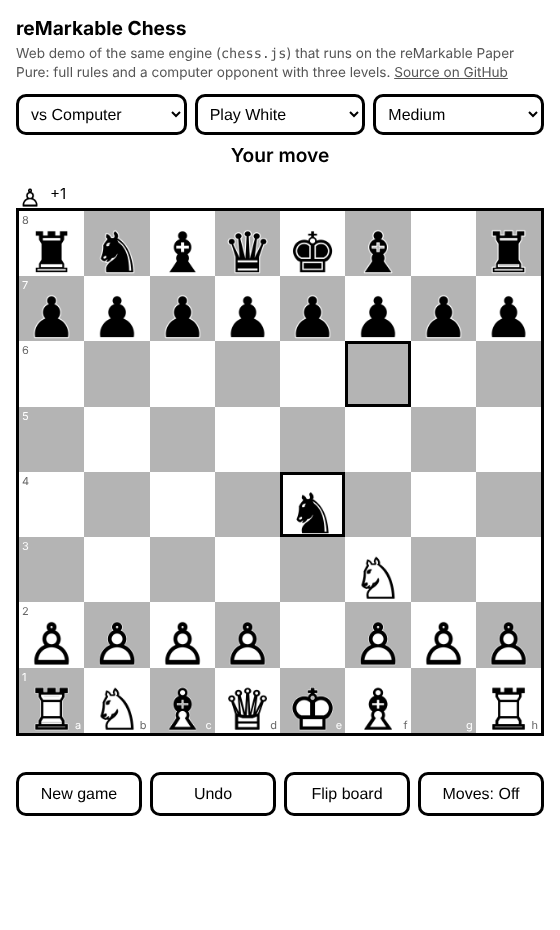

# reMarkable Chess

A standalone chess game for the **reMarkable Paper Pure**, built as an [AppLoad](https://github.com/asivery/rm-appload) (xovi) QML app. Play against the computer or pass the tablet to a friend. High-contrast, animation-free UI designed for e-ink.

**[Live web demo](https://GlitchToGlory.github.io/remarkable-chess/)** (same chess engine as the tablet app)



**[Chess app running on a reMarkable Paper Pure](docs/photo.jpg)**

## Features

- Full rules: castling, en passant, promotion (with piece choice), check, checkmate and stalemate
- Draws by the 50-move rule, threefold repetition and insufficient material
- Computer opponent with three levels (Easy, Medium, Hard): alpha-beta search with quiescence, iterative deepening, piece-square tables and an endgame "mop-up" term so it can finish games
- Play as White, Black or random, or two players on one tablet
- Tap a piece to see its legal moves (dots for moves, rings for captures); last move and check are highlighted. On Hard the legal-move hints are switched off
- Refresh button (top right) flashes the screen to clear e-ink ghosting without affecting the game
- Move list in standard algebraic notation (Moves: On/Off, off by default; with it off the board fills the screen width), captured pieces with material count, undo and board flip
- Engine lives in one file (`src/qml/chess.js`) shared by the tablet app and the web demo, with tests including standard perft move-generation counts

## How to play

- **Menu** opens the menu: pick an opponent (Computer or Two players), your colour and the difficulty, then **Start new game**. **Back to current game** returns to a game in progress, and **Close Chess** exits the app.
- Tap a piece, then tap where it should go. When a pawn reaches the last rank you choose its promotion piece.
- **Undo** takes back your last move (and the computer's reply).
- **Flip board** turns the board round.
- **Moves: Off / On** shows or hides the move list. It's off by default, which lets the board fill the width of the screen.
- The **refresh** icon (top right) flashes the screen black for a moment to clear e-ink ghosting. The game is not affected.

## Install on the tablet

Requires developer mode with xovi + AppLoad already installed.

1. Download `chess.zip` from the Releases page and unzip it (or build it, see below).
2. With the tablet connected by USB (password: Settings → Help → About):

   ```
   scp -O -r chess root@10.11.99.1:/home/root/xovi/exthome/appload/
   ```

3. In AppLoad, tap **Reload**. "Chess" appears in the launcher.

To close the app, tap **Menu → Close Chess** (or drag from the centre-top of the screen to the centre).

## Build from source (macOS)

```
brew install qt node
./build.sh
```

This runs the tests, compiles the QML and piece images into `resources.rcc`, and produces `dist/chess/` and `dist/chess.zip`. It also copies the engine and piece images into `docs/` so the web demo stays in sync.

Preview the tablet UI on your Mac before copying it over:

```
qml src/qml/main.qml
```

## Layout

```
src/qml/main.qml         tablet UI
src/qml/chess.js         rules, move generation, AI and game state (shared with the web demo)
src/qml/pieces/          piece images
src/resources.qrc        Qt resource manifest
package/                 manifest.json + icon.png for AppLoad
docs/                    GitHub Pages demo
tests/test.js            node tests/test.js  (add --deep for deeper perft)
tools/make_pieces.py     regenerates the piece images and icon
tools/make_refresh_icon.py  regenerates the refresh icon
```

## Notes

- The computer runs on the tablet's main thread, so the screen pauses briefly while it thinks (Hard takes a few seconds, and is capped at 20 seconds per move).
- Piece images are drawn from the chess glyphs in the DejaVu Sans font (Bitstream Vera / DejaVu font licence).
- Not affiliated with reMarkable AS.

## License

MIT
